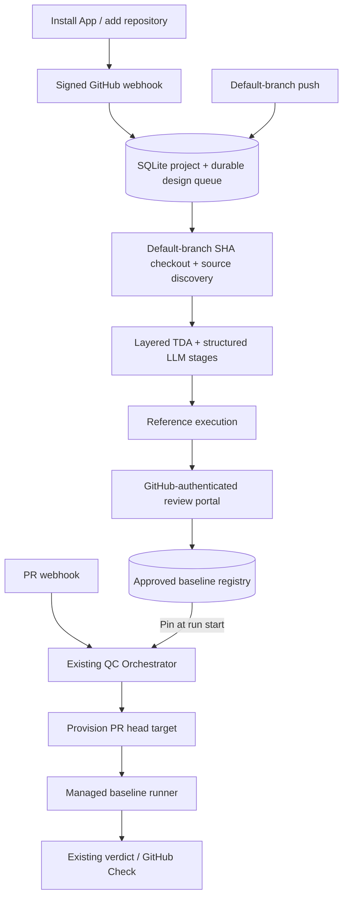

# Managed TDA behind the existing GitHub App

The repository user installs the existing App, signs into its portal and reviews the generated
baseline. No per-repository TDA CLI, worker registration, storage path or baseline version edits
are required. Missing source documents or runtime information are requested in the portal.



## One-time App operator setup

From `qc-agent`, install the bundled package into the backend environment:

```powershell
.venv\Scripts\python.exe -m pip install -r requirements-tda.txt
```

Configure these once for the shared App backend, alongside the existing App ID/key/webhook secret:

```dotenv
GITHUB_CLIENT_ID=<GitHub-App-client-ID>
GITHUB_CLIENT_SECRET=<GitHub-App-client-secret>
GITHUB_APP_SLUG=<existing-App-slug>
AGENT_QC_PUBLIC_URL=https://your-existing-app-host
AGENT_QC_TDA_ENABLED=true
AGENT_QC_TDA_DIR=.data/test-design
OPENAI_API_KEY=<server-side-LLM-key>
TDA_OPENAI_API_KEY=<separate-TDA-key>
```

`AGENT_QC_TDA_MODEL` optionally selects a separate design model; empty uses `OPENAI_MODEL`.
In the portal's Configuration tab, use the searchable file/folder picker before saving
and generating tests. The picker lists paths from the repository default branch through
GitHub API without reading document content or calling the LLM. Folders expand recursively to supported
Markdown/TXT/RST/JSON/YAML sources. Documents outside those paths are not auto-discovered.
An empty list uses only codebase sources. Inline acceptance-criteria input has been removed
from this portal workflow; previously saved inline text is not used for new managed designs. Code/schema/tests
remain included alongside selected documents, subject to the input budget. Paths are read
from the default-branch checkout; unsupported/missing paths and oversized selected sources
are reported before invoking the LLM. Credential files and excluded directories remain omitted.

The Configuration tab also accepts uploaded UTF-8 Markdown/TXT/RST/JSON/YAML files.
Uploads are stored in the backend database, scoped to a project, with immutable content
hashes. Select their checkboxes and save to use them alongside repository documents.
Uploading alone does not generate tests or invoke the LLM. Up to 50 uploaded documents
are stored per project; each file and the selected source total obey the TDA input budget.
Uploaded content is copied into the reference checkout for analysis and retained as evidence
in the generated baseline. Deselecting a file excludes it from future designs; it does not
delete stored documents or change an existing baseline. PDF/DOCX extraction is not supported.
`OPENAI_API_KEY` is for QC; `TDA_OPENAI_API_KEY` is exclusively for TDA. There is no
fallback to the QC key. Set the TDA key in the backend `.env` and restart the backend.
For accounting separation, create the TDA key in a separate provider project. TDA's
per-stage input/output token usage is also recorded in each job's `events.jsonl`.
Choose a compatible reasoning effort or leave `AGENT_QC_TDA_REASONING_EFFORT` empty.

Update the existing GitHub App registration:

| Setting | Value |
|---|---|
| Webhook | Existing `/webhooks/github` |
| User authorization callback | `https://your-existing-app-host/auth/github/callback` |
| Setup URL | `https://your-existing-app-host/app/onboarding` |
| Request OAuth on install | Off; the portal starts a browser-bound state/PKCE login |
| Subscribed events | Existing pull_request plus push |

Installation and repository-access events are handled by the same webhook. The application
also reconciles existing installations at startup in non-dry-run mode. Existing permissions
remain Contents read, Metadata read, Checks write and Pull requests write. No Contents write
permission or PR source changes are needed.

OAuth setup follows [GitHub's user access token web flow](https://docs.github.com/en/apps/creating-github-apps/authenticating-with-a-github-app/generating-a-user-access-token-for-a-github-app).
The manifest distinguishes callback/setup URLs from its registration `redirect_url`, following
[GitHub's manifest specification](https://docs.github.com/en/apps/sharing-github-apps/registering-a-github-app-from-a-manifest).
Editing the local manifest does not update an already registered App; its owner must update
the registration settings once. Start/restart the backend after its environment is configured.

For container packaging, build from the qc-agent repository root:

```powershell
docker build -f Dockerfile.with-tda -t agent-qc-with-tda .
```

Mount durable storage and the private key using your normal deployment configuration.
Use one backend process/consumer with the current SQLite queue; distributed leases are not implemented.

## Repository user flow

1. Install App or add the repository to an existing installation.
2. Open the setup portal and log in with GitHub.
3. The App discovers PRD/SRS/acceptance documents, OpenAPI, schema, code and existing tests.
4. If missing, add requirements or choose source documents directly in the portal.
5. The service creates a draft and checks it against an immutable default-branch reference.
6. Review test cases, assertions, evidence, coverage and reference results; approve or request changes.
7. Future PRs automatically use the active baseline. A default-branch push creates a new design job;
   the previously approved version remains active until its replacement is reviewed.

An unsigned setup query/installation ID never grants access. GitHub OAuth verifies the user;
repository write/maintain/admin permission is checked server-side. Mutations require a session
and CSRF header, and fresh GitHub permission checks. Read permission checks may be cached for
60 seconds. OAuth state is one-use, browser-bound and uses PKCE. GitHub user access tokens are
discarded after identity verification; only random hashed local sessions are persisted.
App authorization revocation removes user sessions. Removal/suspension disables project access
and stops new design work. A draft from an older design job cannot replace the latest project job.

## Automatic runtime and explicit gaps

The portal no longer exposes application entrypoint/startup/healthcheck configuration.
Every managed design rediscovers the environment from the default-branch checkout, ignoring
previously saved manual target profiles. The local pilot recognizes a single FastAPI/Flask
app without importing project code, or a root Express app whose package.json start script
directly invokes node with an entrypoint containing a literal listen port and GET route.
FastAPI/Flask use allocated local ports; Node uses its evidenced port and refuses an occupied
port. A trusted default-branch `.agent-qc.yaml` target declaration also takes precedence.
Unsupported or ambiguous services produce explicit unverified environment findings, without
asking repository users to configure startup commands. Dependencies must already be available
in the backend runtime. No model-generated startup commands are executed.

Mutating HTTP tests are disabled by default. Existing backend project policy is preserved;
the portal no longer exposes the mutation checkbox or automatically grants mutation permission.
both reference validation and PR execution use that project policy. API bearer credentials use
the server-side name `PROJECT_<installation_id>_<repository_id>_API_TOKEN`, never the global
standalone worker token. Declared target environment secrets must use the same project prefix,
for example `secret://PROJECT_123_456_DATABASE_URL`. Credentials are not sent in LLM context.
Target processes inherit a small OS/runtime environment, not the backend's LLM/OAuth credentials.

TDA approves test design independently of application execution. The App defaults to
`AGENT_QC_TDA_REFERENCE_EXECUTION=false`; optional reference results are informational and
stored as hashed baseline snapshots. Missing runtime prerequisites are reported by QC,
while invalid tests or missing oracle evidence still block design approval.
Managed QC uses Docker isolation with HTTP, unit, browser, k6 and AI adapters; see
[multi-runner scope and operation](multi-runner-testing.md) for supported runtimes and limits.

## Persistence and QC binding

`agent-qc.sqlite3` contains design projects/jobs/baselines, hashed browser sessions and review audit.
Artifacts are stored under:

```text
.data/test-design/
  projects/<project_id>/baselines/<version>/
  runs/<design_job_id>/attempt-<n>/
```

The registry owns the active pointer. QC records the selected baseline in its persisted run
and adds exactly one managed `baseline.http` task per repository. The managed runner checks
installation/repository scope, approved registry state, storage boundary, manifest and checksums.
It reads tests outside PR checkout and returns normalized per-case evidence to the existing verdict.
No repository-level worker registration or baseline YAML is required for this path.

Before initial approval, PR reports explicitly show baseline readiness as unknown; the ordinary
QC checks still run. A failing/blocked baseline is never converted into pass. The standalone
external-worker path remains available for deployments that choose separate worker processes.

Design jobs survive restart and recover up to three interrupted attempts. Provider calls are
bounded; shutdown stops between calls and performs cleanup. Superseded/disabled jobs stop before
further model calls. Complete source changes still require a new review. Current artifacts/reports
are local trusted evidence, not signed attestations; code coverage and diff-based test selection
are not implemented.

Managed repository run details also require a verified GitHub session with repository access,
or the backend's operator API bearer token. Browser responses containing design/run data are
not cacheable. Permission checks bind both the GitHub login and verified user ID.
