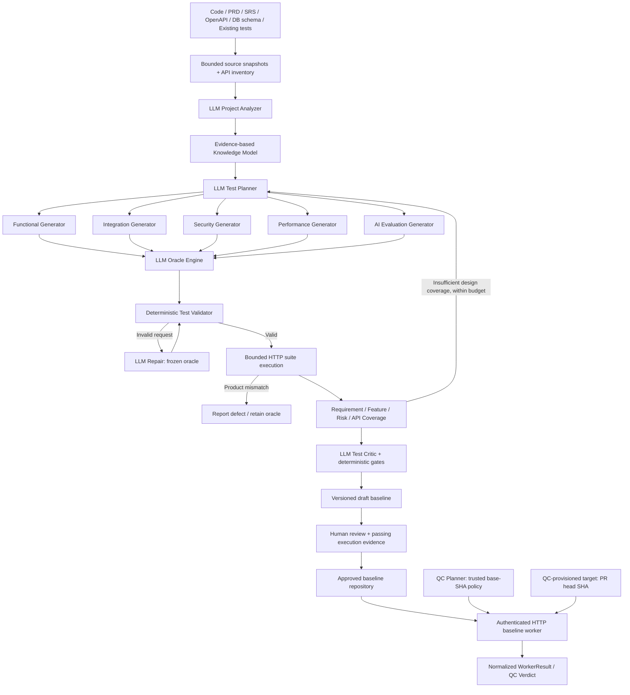

# Layered LLM Test Design Agent

Dependency direction: infrastructure/composition root → application → domain.
Application depends on ports for LLM, source reads, execution, artifacts and baseline publication.

| Layer | Files and responsibility |
|---|---|
| Domain | `domain/contracts.py`: typed entities and stage schemas; `domain/rules.py`: evidence, references, request/oracle/dependency validation |
| Application | `application/orchestrator.py`: bounded lifecycle; `stages.py`: analyzer/planner/generators/oracle/repair; `coverage.py`; `quality.py`: critic |
| Infrastructure | `sources.py`: explicit bounded local paths and OpenAPI inventory; `openai_agent.py`: Responses API; `artifacts.py`: events/results; `baselines.py`: immutable draft packaging; `qc_worker.py`: trusted-baseline HTTP execution service |
| Portable execution | `runner.py`: fixed declarative HTTP executor, copied into baseline for standalone pytest |
| Entry point / compatibility | `__main__.py`: composition root and CLI; `pipeline.py`: v1 compatibility, integrity, approval and QC export |

The LLM analyzes selected raw sources, returning source IDs and exact quotes. Requirements
and oracle assertions require normative PRD/SRS/OpenAPI evidence; implementation and existing
test output are observational sources. Matching a quote proves provenance, not semantic
entailment: critic and human review must still check that the expected value is justified.

All five generators use distinct stage instructions and a shared typed registry. Executable
scope is HTTP functional/security cases, ordered integration steps with cleanup, sequential
latency smoke samples with explicit SLO, and deterministic JSON AI ground truth. Missing
load/rubric/UI/DB adapters must be disclosed as gaps rather than fabricated execution.

Validator checks every step oracle, known operation mapping, dependency cycles and invalid
dependency propagation. Repair runs only for request-contract issues, preserving case/scenario
identity, step count, dependencies, repetition, cleanup and the complete oracle. Product defects
never trigger repair. Environment failures are reported, never turned into passing evidence.

Coverage uses deterministic set membership over extracted requirements/features/risks and the
canonical OpenAPI operation inventory. Designed coverage counts valid oracle-backed cases;
executed coverage counts cases whose assertions ran (pass or product defect). Blocked and
environment failures do not count. Code coverage remains null without an instrumented adapter.
Empty feature/risk/API denominators are explicitly not applicable, not reported as 100%.

Replanning adds scenarios without rewriting existing cases and is bounded by max rounds, cases,
repairs and provider calls. Open questions remain conservative blockers until sources/design
are corrected and regenerated. The critic receives gaps and failures even when coverage cannot
be satisfied; such a draft can be reviewed but cannot be approved.

The execution report is intentionally outside the baseline directory. Product failures
cannot trigger assertion changes. Integrity covers payload files; the local manifest
and review metadata are not cryptographically authenticated. Production consumption
requires a trusted baseline resolver and signed artifacts or trusted immutable storage.

`baseline.http` is registered in the QC capability catalog and uses the existing external-agent
transport/registry. Its worker reads only an approved version from an operator-configured
storage root; it ignores PR-provided source paths. QC's base-SHA configuration pins the version
and the existing target provisioner supplies the PR service URL. Worker results preserve test
IDs and baseline version and distinguish product findings from blocked/environment execution.

Worker registration/start and policy changes are explicit deployment steps, not automatically
applied to running QC services. There is no latest-version discovery or affected-test selection
yet. The worker store is in memory, supports two active tasks and retains at most 100 jobs.
Cancellation is cooperative; an in-flight request can take up to its 10-second timeout to finish.
